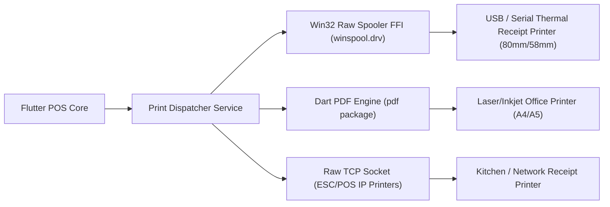

# ALFA SOFT — SYSTEM ARCHITECTURE SPECIFICATION (FLUTTER WINDOWS C++ RUNNER)

## 1. High-Level Architectural Topology

```mermaid
flowchart TB
    subgraph ClientWorkstation["Client Workstation (Windows Desktop)"]
        subgraph NativeWinRunner["Native Windows C++ Runner (Win32 Subsystem)"]
            WinMain["main.cpp (Win32 WinMain Entry)"]
            WinWindow["FlutterWindow / Win32Window Host"]
            DirectXHost["DirectX 12 / ANGLE Surface"]
        end

        subgraph FlutterEngine["Flutter Desktop Engine (C++)"]
            SkiaImpeller["Skia / Impeller Rendering Pipeline"]
            PlatformChannels["Platform Channels & Native Plugins"]
            DartVM["Dart AOT Compiled Runtime (Zero-JIT)"]
        end

        subgraph AppApplication["ALFA SOFT Application Core (Dart 3.9+)"]
            UI["UI Layer (Widgets, Custom Layered Design System)"]
            StateMgr["State Management (Riverpod / BLoC)"]
            subgraph DomainCore["Domain & Business Logic Layer"]
                POS["POS Engine"]
                Accounting["Accounting Engine"]
                Inventory["Inventory Costing Engine (FIFO / MAC)"]
                Security["RBAC & Security Service"]
            end
            DataLayer["Data Access & Repository Layer"]
        end

        subgraph NativeFFI["Direct C-ABI FFI & Local Storage"]
            SQLiteFFI["SQLite 3 Native Engine (WAL Mode)"]
            Win32Printing["Win32 Raw Spooler Driver (ESC/POS)"]
            LocalDB[("Local SQLite 3 Database File")]
        end
    end

    subgraph Network["LAN or WAN (TLS 1.3)"]
        LANSync["Local LAN P2P Sync (mDNS)"]
        CloudSync["Cloud REST / WebSocket Gateway"]
    end

    subgraph CentralServer["Central Cloud Infrastructure (NestJS + PostgreSQL)"]
        CentralAPI["NestJS Central Sync Gateway"]
        SyncEngine["Central Conflict Resolver & Event Store"]
        PostgresDB[("PostgreSQL 16 Cluster")]
    end

    subgraph DeveloperPortal["Developer Licensing Authority (Isolated Portal)"]
        PortalApp["Developer Admin Web App"]
        Signer["Ed25519 Private Key Signer"]
    end

    WinMain --> WinWindow
    WinWindow --> DirectXHost
    DirectXHost --> SkiaImpeller
    SkiaImpeller --> UI
    UI --> StateMgr
    StateMgr --> DomainCore
    DomainCore --> DataLayer
    DataLayer -- "In-Process C-ABI Call (Zero IPC Latency)" --> SQLiteFFI
    DataLayer -- "Raw Byte Stream" --> Win32Printing
    SQLiteFFI --> LocalDB
    DataLayer -.-> LANSync
    DataLayer -.-> CloudSync
    CloudSync --> CentralAPI
    CentralAPI --> SyncEngine
    SyncEngine --> PostgresDB
    DeveloperPortal -.-> "Cryptographic Signed License File" .-> ClientWorkstation
```

---

## 2. Desktop Shell Architecture (Windows C++ Runner)

### 2.1 The Native C++ Host (`windows/runner/`)
Unlike web wrappers, Flutter on Windows executes inside a compiled Win32 C++ application:
1. **Entry Point (`main.cpp`)**:
   - Initializes COM libraries (`CoInitializeEx`).
   - Creates the top-level Win32 window (`FlutterWindow`).
   - Embeds the Flutter Engine controller.
2. **Window Management & Frame Customization**:
   - Implements native borderless framing, custom min/max/close controls, and DPI-aware window resizing via `window_manager`.
   - Supports seamless full-screen POS mode with hardware keyboard capture.
3. **Zero IPC Overhead**:
   - Because SQLite and native drivers interact directly through the Dart FFI (Foreign Function Interface), calls occur directly in-memory via C-ABI pointers with zero JSON serialization or IPC message latency.

---

## 3. Local Application Service & Data Layer

### 3.1 Native SQLite Engine Configuration (FFI)
Each client workstation executes against an optimized local SQLite database instance via `sqlite3`:
- **Journal Mode**: `PRAGMA journal_mode = WAL;` (Write-Ahead Logging allows concurrent reads alongside active writes).
- **Foreign Key Constraints**: `PRAGMA foreign_keys = ON;` (Strict referential integrity).
- **Busy Timeout**: `PRAGMA busy_timeout = 5000;` (Prevents immediate `SQLITE_BUSY` contention errors).
- **Synchronous**: `PRAGMA synchronous = NORMAL;` (Safe with WAL and maximizes disk write performance).
- **Cache Size**: `PRAGMA cache_size = -64000;` (~64MB memory page cache).

### 3.2 Unit of Work & Transaction Management
All financial and stock operations are wrapped in atomic database transactions:
```dart
abstract class UnitOfWork {
  Future<T> execute<T>(Future<T> Function(DatabaseTransaction tx) operation);
}
```
If any subordinate step (e.g., updating stock ledger, recording journal lines, or updating customer balances) fails, an immediate rollback restores the database to a verified consistent state.

---

## 4. Hardware Peripherals & Direct Spooling



- Direct ESC/POS byte streaming sends hardware pulses (cash drawer kick `ESC p 0 25 250`), paper cut commands (`GS V 66 0`), and rasterized Arabic text without relying on Windows print dialogs.
