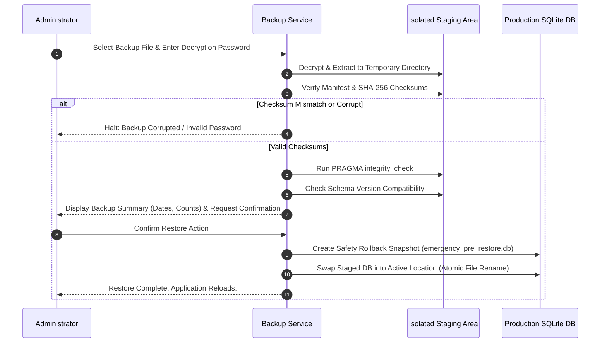

# ALFA SOFT — BACKUP, RESTORE & DATA ARCHIVE SPECIFICATION

## 1. Backup Architecture & Package Structure

ALFA SOFT implements a comprehensive data protection subsystem designed to prevent catastrophic data loss under hardware failure, ransomware attacks, or accidental corruption.

### 1.1 Archive Package Format (`.alfabackup`)
A standard backup package is an encrypted, compressed archive structured as follows:
```
backup_package_20261107_120000.alfabackup
├── manifest.json            # Metadata, schema version, checksums, statistics
├── database.sqlite          # Consistent SQLite snapshot taken via SQLite Online Backup API
├── attachments/             # Scanned invoices, receipts, customer documents
└── checksums.sha256         # SHA-256 hashes of all constituent files
```

### 1.2 Manifest Specification
```json
{
  "application": "ALFA SOFT",
  "version": "1.0.0",
  "schemaVersion": 4,
  "backupType": "FULL",
  "createdAt": "2026-11-07T12:00:00Z",
  "companyId": "comp_01J...",
  "companyName": "شركة ألفا للتجارة",
  "recordCounts": {
    "products": 4500,
    "salesInvoices": 18230,
    "journalEntries": 36460,
    "customers": 850
  },
  "databaseChecksum": "a1b2c3d4e5...",
  "encryptionAlgorithm": "AES-256-GCM"
}
```

---

## 2. Backup Execution Procedures

### 2.1 Consistent SQLite Backup Creation
To avoid capturing transient WAL locks or corrupted pages, live backups use the **SQLite Online Backup API** (`sqlite3_backup_init` / `VACUUM INTO`):
```sql
VACUUM INTO 'E:/AlfaSoft/Backups/staging/database.sqlite';
```
This guarantees an atomic, fully checkpointed copy without requiring the application to terminate or locking active POS sales.

### 2.2 Encryption at Rest
- The archive payload is encrypted with **AES-256-GCM**.
- Key Derivation: User backup password passed through **PBKDF2-HMAC-SHA256** (100,000 rounds) with an 8-byte cryptographic salt stored in the manifest header.

---

## 3. Safe Restoration Protocol

To guarantee that a damaged or incompatible backup file cannot destroy an active operational system:



---

## 4. Retention & Rotation Policy
- **Automated Hourly/Daily Backups**: Retained for 7 days.
- **Weekly Backups**: Retained for 4 weeks.
- **Monthly Backups**: Retained for 12 months.
- Old backups exceeding the retention threshold are automatically pruned during low-traffic maintenance windows.
