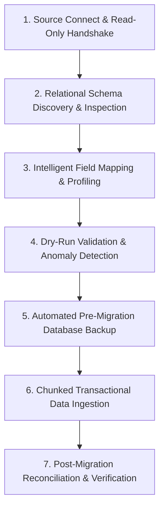

# ALFA SOFT — UNIVERSAL DATA IMPORT & MIGRATION SPECIFICATION

## 1. Objectives & Supported Sources

The Migration Center enables seamless data onboarding from legacy ERP, POS, and accounting software.
- **Relational Databases**: SQLite, MySQL, MariaDB, PostgreSQL, Microsoft SQL Server (via read-only connection strings).
- **Flat Files & Archives**: Excel (.xlsx, .xls), CSV (with auto delimiter detection), JSON, and Structured XML.

---

## 2. 7-Stage Migration Pipeline

### Stage 1: Connection & Safety Guard
- All database connections are opened with strict `READ ONLY` connection flags.
- Under no circumstance does ALFA SOFT execute `INSERT`, `UPDATE`, `DELETE`, or `DROP` on the source legacy database.

### Stage 2: Schema Discovery
Extracts complete metadata:
- Table names, approximate row counts, column names, data types, nullability, primary keys, and foreign key relationships.

### Stage 3: Intelligent Field Mapping
- Heuristic matching compares legacy column headers against ALFA SOFT domain models:
  - `product_name`, `item_title`, `اسم_الصنف`, `اسم_المنتج` $\to$ `products.name_ar`
  - `item_code`, `barcode`, `الباركود`, `كود_الصنف` $\to$ `products.barcode` / `products.sku`
  - `selling_price`, `سعر_البيع`, `price` $\to$ `products.sale_price`
  - `cost`, `cost_price`, `سعر_التكلفة` $\to$ `products.cost_price`
  - `qty`, `stock`, `الكمية`, `رصيد` $\to$ `opening_stock.quantity`
- Users can manually adjust mappings, define default values, or map extra legacy fields into `custom_fields` (JSON payload).

### Stage 4: Dry-Run Validation
Before executing writes:
1. Validates SKU and Barcode uniqueness.
2. Checks for missing parent records (e.g., product referencing non-existent category).
3. Verifies decimal format conversions and date parsing compatibility.
4. Generates an **Import Impact Summary**: Records to Insert, Records to Skip, Warnings.

### Stage 5: Safety Snapshot
An automatic SQLite backup file (`pre_import_snapshot_[timestamp].db`) is created locally prior to committing changes.

### Stage 6: Chunked Transactional Ingestion
- Imports proceed in batches of 500 records per transaction.
- If a catastrophic error occurs, the active transaction is rolled back and the user can review failed rows in an error export file.

### Stage 7: Reconciliation
Calculates row counts and totals (e.g., total opening inventory valuation in source vs imported into ALFA SOFT) and generates an official audit report.
