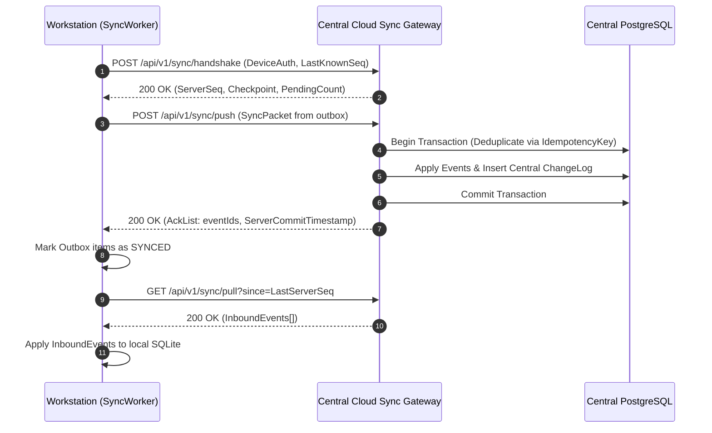

# ALFA SOFT — SYNCHRONIZATION PROTOCOL SPECIFICATION

## 1. Overview & Protocol Objectives

The ALFA SOFT synchronization protocol enables seamless data consistency across distributed desktop workstations operating with intermittent or zero internet connectivity.
The protocol guarantees:
1. **Eventual Consistency**: All nodes converge to an identical state upon successful synchronization.
2. **Idempotence**: Re-sending identical sync packets does not duplicate financial transactions or stock balances.
3. **Partition Tolerance**: Workstations continue processing sales and inventory changes offline without blocking.

---

## 2. Sync Packet Specification

```typescript
export interface SyncPacket {
  protocolVersion: '1.0';
  packetId: string; // UUID v4
  deviceId: string;
  companyId: string;
  branchId: string;
  sentAt: string; // ISO 8601 UTC
  batchSequence: number;
  events: SyncEvent[];
  signature: string; // HMAC-SHA256 of payload signed by device key
}

export interface SyncEvent {
  eventId: string; // Globally Unique ID
  entityType: 'PRODUCT' | 'CUSTOMER' | 'SALES_INVOICE' | 'INVENTORY_MOVEMENT' | 'JOURNAL_ENTRY';
  entityId: string;
  operation: 'INSERT' | 'UPDATE' | 'TOMBSTONE';
  timestamp: string;
  version: number; // Entity optimistic version
  idempotencyKey: string;
  data: Record<string, any>;
}
```

---

## 3. Communication Workflows

### 3.1 Cloud Synchronization (REST / TLS 1.3)



### 3.2 Peer-to-Peer Local Network (LAN) Sync
- **Discovery**: Workstations broadcast presence on the local subnet using mDNS (`_alfasync._tcp.local`).
- **Mutual Authentication**: Handshake uses pre-shared branch tokens or certificates exchanged during initial workstation onboarding.
- **Master Node Election**: In an isolated LAN without internet, the main branch server is designated as the local coordination peer.

---

## 4. Conflict Resolution Matrix

| Entity Type | Conflict Scenario | Resolution Policy |
| :--- | :--- | :--- |
| **Inventory Movements** | Two workstations sell the same item offline simultaneously. | **Additive Ledger Merge**. Both sales are recorded. If physical stock drops below zero, a `STOCK_DISCREPANCY_ALERT` is generated without rejecting either sale. |
| **Sales Invoices** | Duplicate invoice number generated offline on different workstations. | **Namespaced Numbering**. Invoice numbers incorporate branch and terminal codes: `INV-[BranchCode]-[TerminalCode]-[Seq]`. Zero collisions possible. |
| **Customer Master Data** | Customer address updated simultaneously on Station A and Station B. | **Field-Level Last-Write-Wins (LWW)** or manual review if conflicting values are substantive. |
| **Chart of Accounts / Settings** | Structural configuration modified concurrently. | **Admin Conflict Review Queue**. Retained in `sync_conflicts` for manual resolution. |
